# ProjectDB Order Management REST API

## Project overview

This project is a Spring Boot REST API connected to the existing `project-db` MariaDB database. The aim is to provide a small order-management back-end while also demonstrating the main database techniques covered during the course.

The API works with resources such as orders, order items, customers, suppliers, products, and product categories. In addition to REST operations, the database uses relationships, a view, a trigger, indexes, transactions, a scheduled event, system-versioned temporal history, and database users with different privilege levels.

## Technologies

- Java 17
- Spring Boot
- Spring Web
- Spring Data JPA
- Jakarta Persistence / JPA
- MariaDB
- Maven
- HeidiSQL
- PowerShell for manual REST API testing

## Running the application

1. Start MariaDB and make sure the `project-db` database is available.
2. Check the database connection settings in `src/main/resources/application.yaml`.
3. Run `ProjectdbApplication` from IntelliJ.
4. In the current development configuration, the API runs on:

```text
http://localhost:8081
```

Database passwords should not be written in this README or committed to the repository.

---

## REST API

Requests and responses use JSON. `POST` and `PUT` requests use `Content-Type: application/json`.

### Orders

| Method | Endpoint | Purpose |
|---|---|---|
| GET | `/api/orders` | Return all orders |
| GET | `/api/orders/{id}` | Return one order |
| GET | `/api/orders/{id}/items` | Return the items belonging to an order |
| GET | `/api/orders/{id}/details` | Return an order together with its items |
| POST | `/api/orders` | Create a basic order |
| POST | `/api/orders/with-items` | Create an order and its order items in one transaction |
| PUT | `/api/orders/{id}` | Update an existing order |
| DELETE | `/api/orders/{id}` | Delete an order |

Example basic order request:

```json
{
  "customerId": 51914,
  "shippingAddressId": 51914,
  "status": "NEW"
}
```

Example transactional order request:

```json
{
  "order": {
    "customerId": 51914,
    "shippingAddressId": 51914,
    "status": "NEW"
  },
  "items": [
    {
      "productId": 426,
      "quantity": 2,
      "unitPrice": 736.44
    },
    {
      "productId": 551,
      "quantity": 1,
      "unitPrice": 611.67
    }
  ]
}
```

### Suppliers

| Method | Endpoint | Purpose |
|---|---|---|
| GET | `/api/suppliers` | Return all suppliers |
| GET | `/api/suppliers/{id}` | Return one supplier |
| POST | `/api/suppliers` | Create a supplier |
| PUT | `/api/suppliers/{id}` | Update a supplier |
| DELETE | `/api/suppliers/{id}` | Delete a supplier |

Example supplier request:

```json
{
  "name": "Test Supplier",
  "contactName": "John Test",
  "phone": "0405551234",
  "email": "testsupplier@example.com"
}
```

### Customers

| Method | Endpoint | Purpose |
|---|---|---|
| GET | `/api/customers` | Return all customers |
| GET | `/api/customers/{id}` | Return one customer |
| POST | `/api/customers` | Create a customer |
| PUT | `/api/customers/{id}` | Update a customer |
| DELETE | `/api/customers/{id}` | Delete a customer |

The project also contains product and product-category controllers from the earlier implementation. Their endpoint behavior should match the controller code in the repository and should be kept in this section if those endpoints are part of the final submitted API.

---

## CRUD verification

### Order CRUD

The order resource was tested in the normal CRUD sequence: create, read, update, and delete. One test order was followed through the whole sequence so that the results were easy to verify.

**Create**

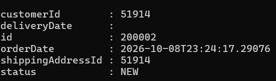

*Figure 1. Successful POST request creating a new order through the REST API.*

**Read**

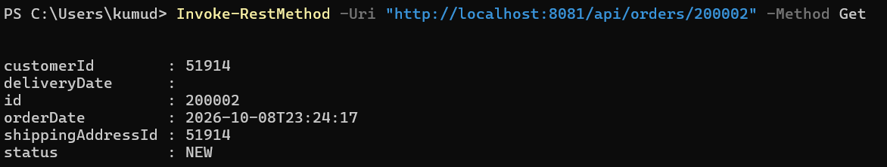

*Figure 2. Successful GET request retrieving the newly created Order ID 200002.*

**Update**

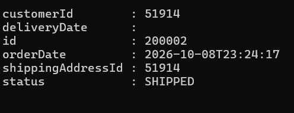

*Figure 3. Successful PUT request updating Order ID 200002 from `NEW` to `SHIPPED`.*

**Delete**

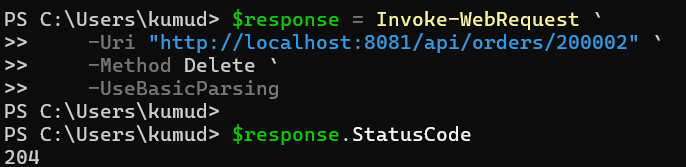

*Figure 4. Successful DELETE request removing Order ID 200002 and returning HTTP status `204 No Content`.*

**Delete verification**

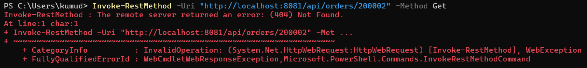

*Figure 5. A GET request after deletion returns `404 Not Found`, confirming that Order ID 200002 no longer exists.*

### Supplier CRUD

A second complete CRUD flow was implemented and tested for suppliers.

**Create**

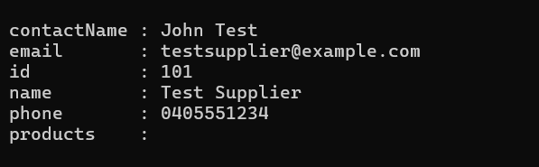

*Figure 6. Successful POST request creating Supplier ID 101.*

**Read**

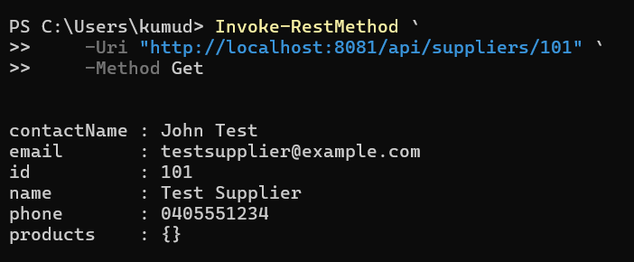

*Figure 7. Successful GET request retrieving Supplier ID 101.*

**Update**

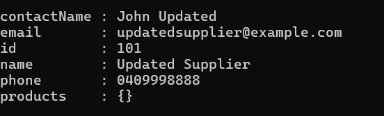

*Figure 8. Successful PUT request updating Supplier ID 101.*

**Delete**

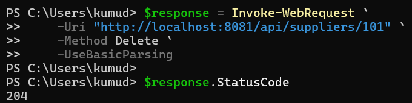

*Figure 9. Successful DELETE request removing Supplier ID 101 and returning HTTP status `204 No Content`.*

**Delete verification**

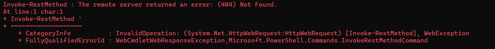

*Figure 10. A GET request after deletion returns `404 Not Found`, confirming that Supplier ID 101 no longer exists.*

---

## Database relationships

The database uses several relationship types.

### Customer to orders — one-to-many

Each order contains a `customer_id` foreign key. One customer can therefore be connected to many orders, while each order belongs to one customer. The `orders` table also contains a foreign key to the shipping address.

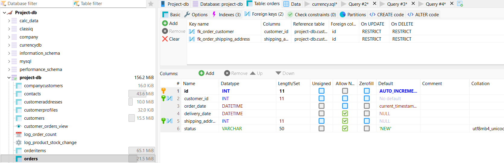

*Figure 11. Foreign-key relationships in `orders`, linking each order to a customer and a shipping address.*

### Orders and products through order items

`orderitems` contains both `order_id` and `product_id`. One order can have many order items, and one product can appear in many order items. The two columns also form the composite key used by the order-item mapping.

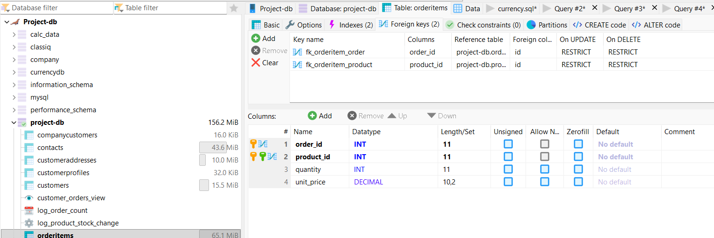

*Figure 12. Foreign-key relationships in `orderitems`, linking order items to orders and products.*

### Products and suppliers — many-to-many

Products and suppliers are connected through the `product_suppliers` join table. A product can have several suppliers, and a supplier can provide several products.

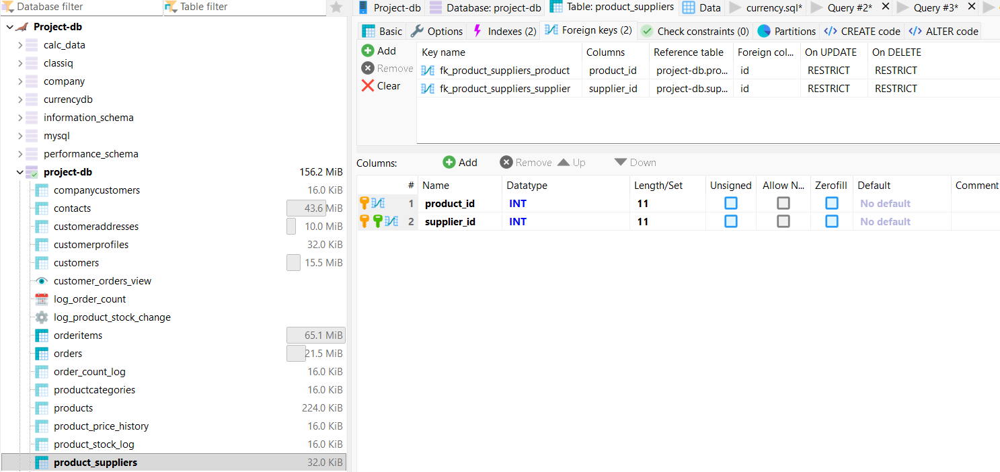

*Figure 13. `product_suppliers` implements the many-to-many relationship between products and suppliers.*

### Customer and customer profile — one-to-one

`customerprofiles.customer_id` references a customer and is also unique. This prevents the same customer from having more than one customer-profile row.

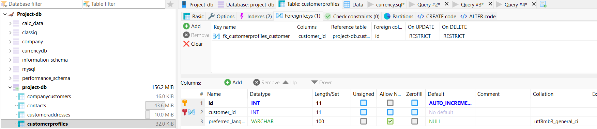

*Figure 14. `customerprofiles.customer_id` references the customer table.*

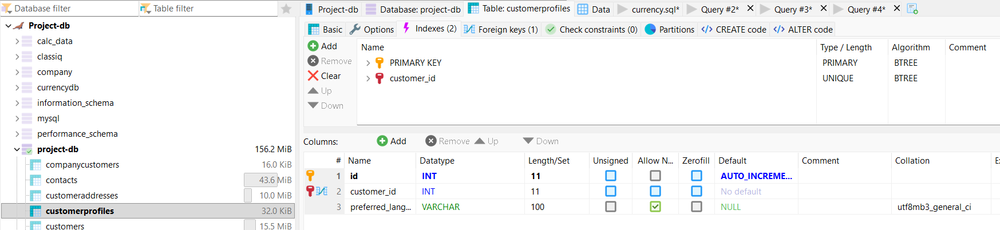

*Figure 15. The unique constraint on `customerprofiles.customer_id` enforces the one-to-one relationship.*

---

## Transactions

Order creation with items is implemented in the service layer using Spring's `@Transactional` annotation. The order is saved first, and then its order items are saved as part of the same transaction.

If one item fails, the complete operation is rolled back. This avoids leaving an order in the database without all of its intended items.

### Successful transaction

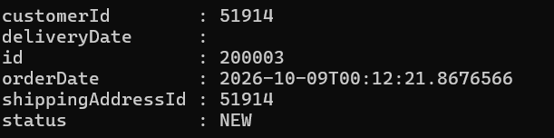

*Figure 16. Successful transactional POST request creating Order ID 200003.*

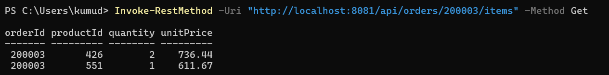

*Figure 17. GET request confirming that two order items were saved for transactional Order ID 200003.*

### Rollback test

A second request deliberately used an invalid product ID. The request failed, and the database was checked afterward.

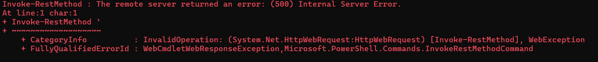

*Figure 18. Transactional POST request fails because an order item references an invalid product.*

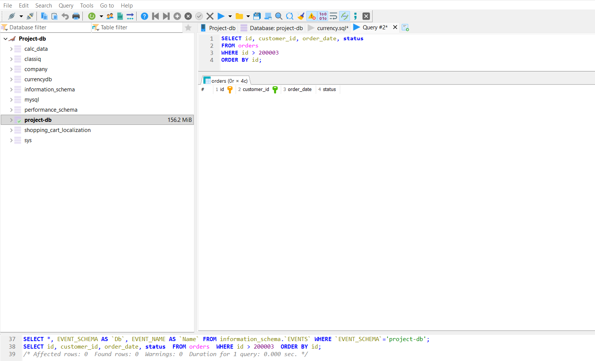

*Figure 19. Database verification shows that no new order was persisted after the failed request, confirming rollback.*

---

## Database view

The `customer_orders_view` view combines information from `orders` and `customers`. It makes it possible to retrieve order data together with the customer's name, email, and phone without writing the join repeatedly.

```sql
CREATE ALGORITHM = UNDEFINED
DEFINER = `root`@`localhost`
SQL SECURITY DEFINER
VIEW `customer_orders_view` AS
SELECT
    orders.id AS order_id,
    orders.customer_id AS customer_id,
    orders.order_date AS order_date,
    orders.delivery_date AS delivery_date,
    orders.shipping_address_id AS shipping_address_id,
    orders.status AS status,
    customers.first_name AS first_name,
    customers.last_name AS last_name,
    customers.email AS email,
    customers.phone AS phone
FROM orders
JOIN customers
    ON orders.customer_id = customers.id;
```

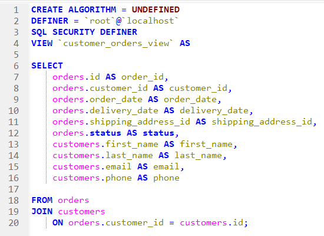

*Figure 20. SQL definition of `customer_orders_view`, joining the `orders` and `customers` tables.*

---

## Trigger and stock log

The database contains the `log_product_stock_change` trigger. It runs after a product row is updated and writes the product ID, previous stock value, and new stock value into `product_stock_log`.

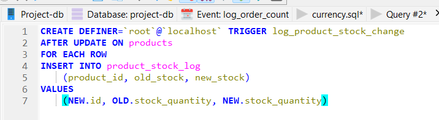

*Figure 21. SQL definition of the `log_product_stock_change` trigger.*

A manual test changed Product ID 1 from stock quantity 136 to 135.

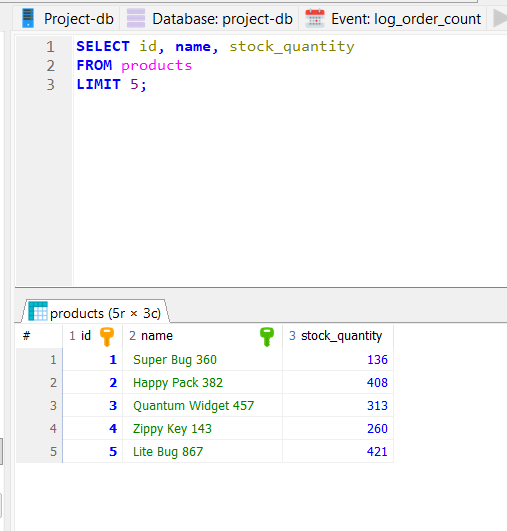

*Figure 22. Product ID 1 before the trigger test, with stock quantity 136.*

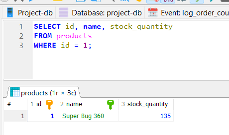

*Figure 23. Product ID 1 after the stock quantity was changed to 135.*

The trigger automatically inserted the change into the log table.

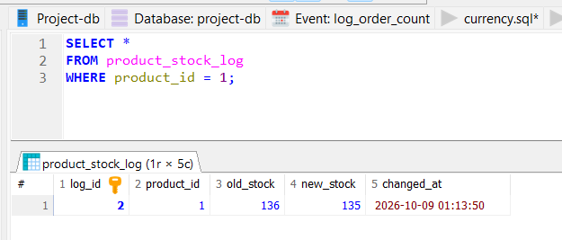

*Figure 24. `product_stock_log` records the old stock value 136 and the new value 135.*

---

## Scheduled database event

The database contains a scheduled event called `log_order_count`. It is configured to run every minute and execute an order-count query without requiring an API request.

```sql
SELECT COUNT(*)
FROM orders;
```

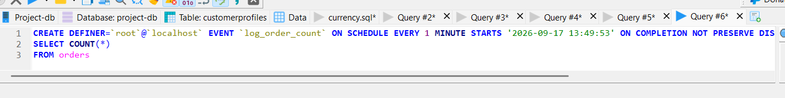

*Figure 25. SQL definition of the `log_order_count` event, scheduled to run every minute.*

This demonstrates MariaDB scheduled-event functionality. The event counts orders; it does not by itself store the count unless its definition is later changed to insert the result into a table.

---

## Indexes

The `orders` table contains a primary-key index and indexes related to its foreign keys. These help MariaDB locate rows efficiently when queries filter or join on those columns.

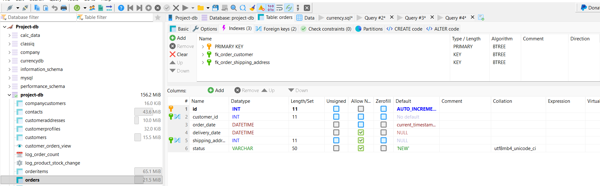

*Figure 26. Indexes defined on the `orders` table.*

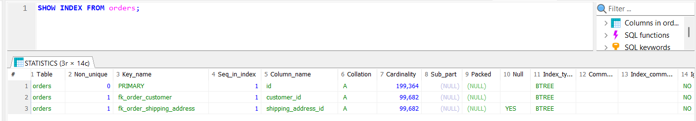

*Figure 27. `SHOW INDEX` output showing BTREE indexes on `customer_id` and `shipping_address_id`.*

To verify actual index selection, the following query was checked with `EXPLAIN`:

```sql
EXPLAIN
SELECT *
FROM orders
WHERE customer_id = 51914;
```

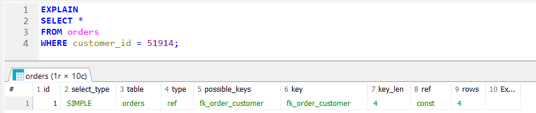

*Figure 28. `EXPLAIN` confirms that MariaDB selects the `fk_order_customer` index.*

---

## Temporal / history feature

`product_price_history` is a MariaDB system-versioned table. Its definition contains `WITH SYSTEM VERSIONING`, which allows MariaDB to preserve earlier versions of changed rows.

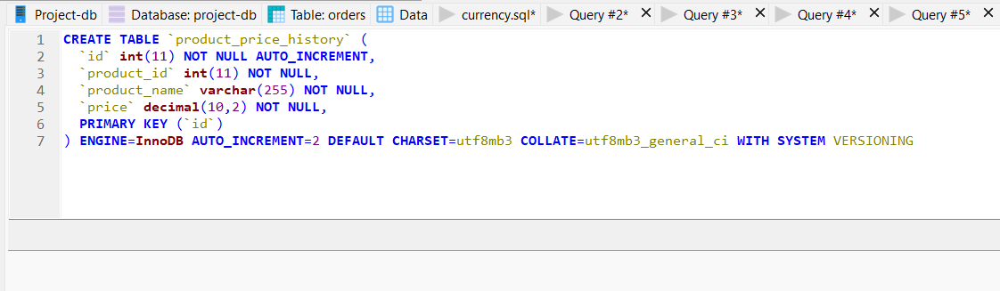

*Figure 29. `product_price_history` is configured with `WITH SYSTEM VERSIONING`.*

Historical versions can be retrieved with:

```sql
SELECT *
FROM product_price_history
FOR SYSTEM_TIME ALL;
```

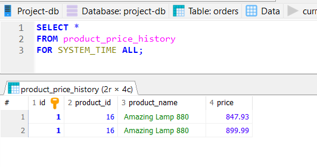

*Figure 30. `FOR SYSTEM_TIME ALL` returns multiple historical price versions for Product ID 16.*

The test result shows two preserved prices for the same logical record, demonstrating that historical versions can be queried instead of being lost after an update.

---

## Database security

The MariaDB server contains separate accounts for different purposes instead of relying on only one unrestricted user.

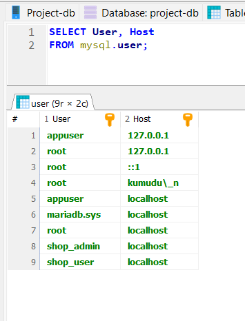

*Figure 31. MariaDB user accounts, including role-specific accounts.*

`shop_admin` has administrative privileges on `project-db`.

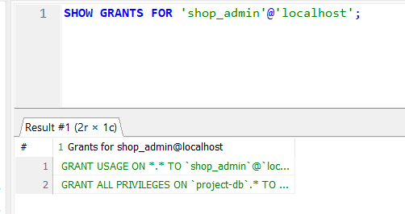

*Figure 32. `shop_admin` has administrative privileges on `project-db`.*

`shop_user` has more limited permissions for normal data operations.

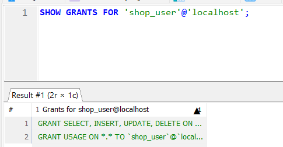

*Figure 33. `shop_user` is limited to normal data-access operations such as SELECT, INSERT, UPDATE, and DELETE.*

This separation demonstrates controlled database access and the principle of giving normal users fewer privileges than an administrator.

---

## HTTP responses and error handling

The API uses normal HTTP status codes to show the outcome of requests.

| Status | Meaning in this project |
|---|---|
| `200 OK` | Successful GET or PUT |
| `201 Created` | Successful POST |
| `204 No Content` | Successful DELETE |
| `404 Not Found` | Requested resource does not exist |
| `500 Internal Server Error` | A server/database error occurred, such as the deliberately failed transaction test |

The CRUD tests also verified that deleted resources return `404 Not Found`.

---

## Verification summary

The following functionality was manually tested during the project:

- Order create, read, update, and delete
- Supplier create, read, update, and delete
- Customer API access
- Order-item retrieval
- Transactional order creation
- Transaction rollback when an invalid product is used
- Customer/order database view
- Product stock-change trigger and log
- Scheduled MariaDB event
- Index definitions and actual index selection with `EXPLAIN`
- MariaDB system-versioned temporal history
- One-to-many, many-to-many, and one-to-one database relationships
- Database users with different privilege levels

---

## Current limitations

The project is functional, but there are still areas that could be improved:

- The REST API does not currently include authentication or authorization.
- Some database tables are not exposed as separate REST resources.
- List endpoints are not paginated.
- Error responses could be made more user-friendly and consistent.
- The current scheduled event counts orders but does not persist the count.
- The transactional order endpoint currently focuses on saving the order and items; automatic stock reduction could be added as a future improvement.

---

## Project structure

The main Java packages are organized as follows:

```text
com.example.projectdb
├── controller
│   ├── CustomerController
│   ├── OrderController
│   ├── ProductCategoryController
│   ├── ProductController
│   ├── SupplierController
│   └── RelationshipTestController
├── dto
│   └── OrderRequest
├── entity
│   ├── CompanyCustomer
│   ├── Customer
│   ├── CustomerProfile
│   ├── Order
│   ├── OrderItem
│   ├── OrderItemId
│   ├── Product
│   ├── ProductCategory
│   └── Supplier
├── repository
│   ├── CompanyCustomerRepository
│   ├── CustomerProfileRepository
│   ├── CustomerRepository
│   ├── OrderItemRepository
│   ├── OrderRepository
│   ├── ProductCategoryRepository
│   ├── ProductRepository
│   └── SupplierRepository
├── service
│   └── OrderService
└── ProjectdbApplication
```

`RelationshipTestController` was useful during development for testing relationships. The main final API is provided by the resource-specific controllers.

---

## Conclusion

The project provides a working Spring Boot REST API on top of the existing `project-db` MariaDB database. The implementation goes beyond basic CRUD by using relationships, transactions, a view, triggers, indexing, a scheduled event, system-versioned temporal data, and database privileges.

The manual tests show that the main API operations work correctly and that the database features behave as expected.
